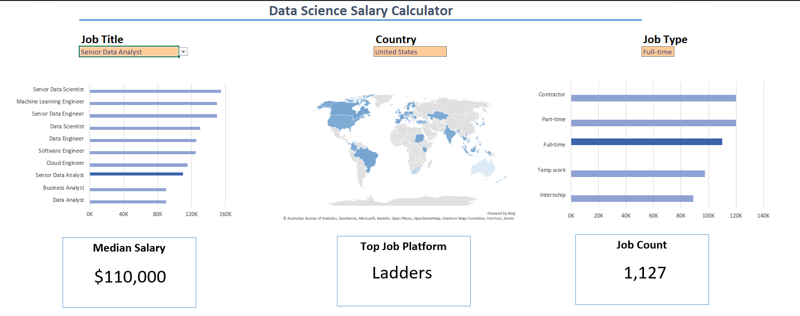
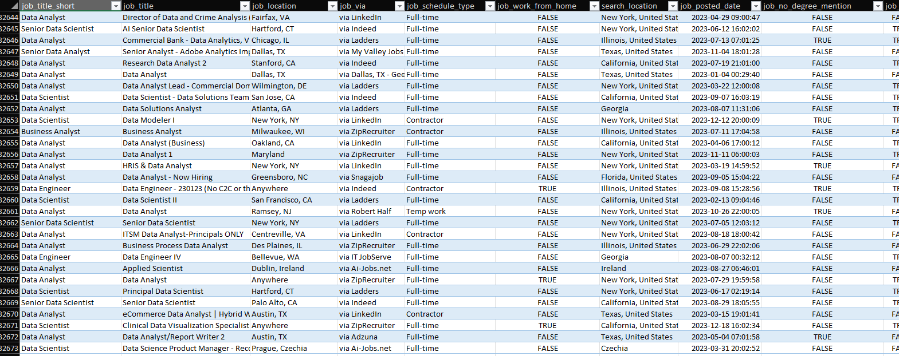

# Data Science Salary Calculator

This Excel project explores salary information from data science job postings. The calculator lets you choose a job title, country and job type, then see how the selected group compares with the wider set of roles in the workbook.

## What you can explore

- Median salary for the selected job title and filters
- Salary comparisons across data and technology roles
- Salary patterns by job type and country
- The number of matching job postings and the most common hiring platform

The workbook includes a dashboard, the underlying job posting data, and supporting lists used for the calculator's dropdowns and summaries.

## Dashboard preview

## Source data preview

## Open the project

1. Download `Salary Calculator Project.xlsx` from this repository.
2. Open it in Microsoft Excel and enable editing if prompted.
3. Go to the `Salary_Calculator` sheet and use the selection fields to choose a job title, country and job type.
4. Review the charts and summary cards on the dashboard. Use the `Data` sheet to inspect the job posting records.

The figures shown on the dashboard depend on the selections in the workbook. For example, the screenshot shows Senior Data Analyst roles in the United States for full-time work.

## Files

- `Salary Calculator Project.xlsx` — the interactive Excel workbook.
- `screenshots/dashboard.png` — a view of the calculator dashboard.
- `screenshots/data.png` — a view of the source data table.

## Notes

This is a portfolio project for exploring job-posting and salary data in Excel. The workbook's results describe the records included in the file; they should not be treated as a guarantee of current market pay.
